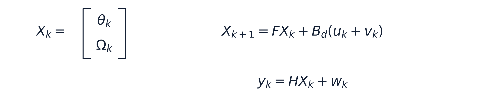
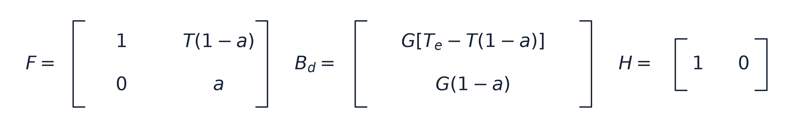
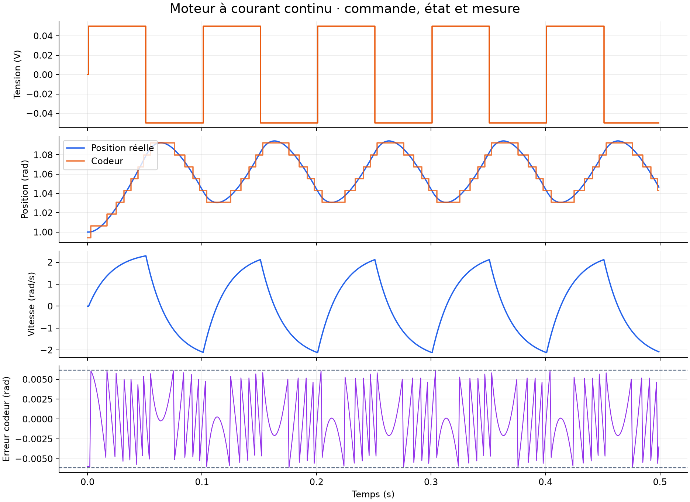
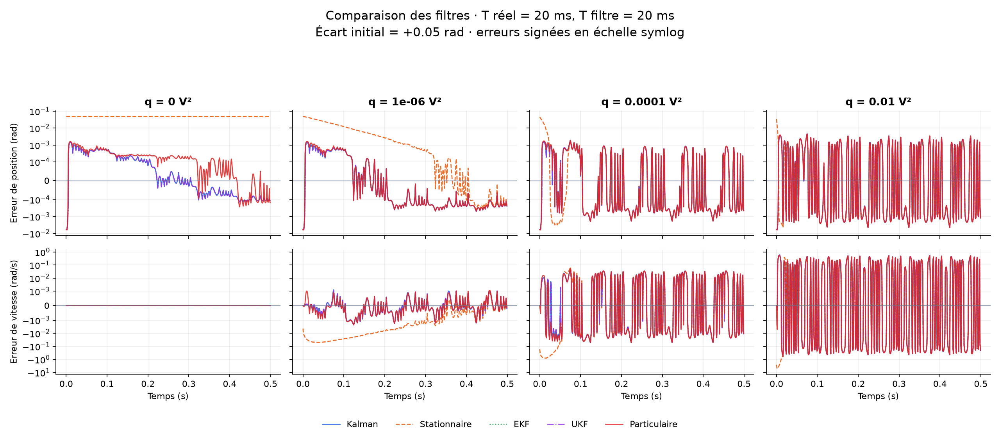
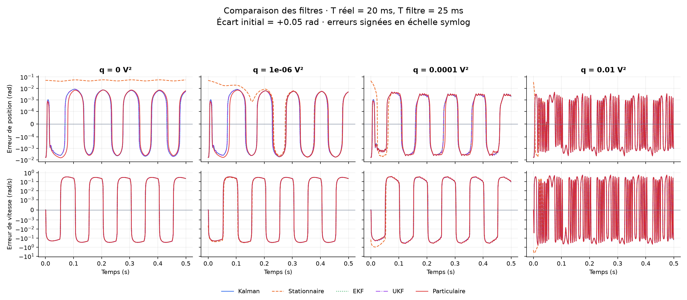

# State Estimation · Kalman to Particle Filters

**Estimer la position et la vitesse d’un moteur à courant continu à partir de sa commande et d’un codeur angulaire.**

Projet Python autour du TP MSTAT DataSIM : Kalman optimal, Kalman stationnaire, EKF, UKF et filtre particulaire bootstrap. Les cinq méthodes sont appliquées au **même moteur**, avec les mêmes mesures et conditions initiales.

> Le moteur étudié est linéaire : EKF et UKF servent ici à comparer les implémentations. Ils doivent retrouver Kalman, aux erreurs numériques près. Le modèle scalaire non linéaire proposé dans la partie 3 de l’énoncé n’est pas implémenté dans ce dépôt Python.

[Installation](#installation) · [Lancer les simulations](#lancer-les-simulations) · [Résultats](#résultats) · [Organisation](#organisation)

## Installation

### Préparer le projet

Télécharger ou cloner ce dépôt, puis ouvrir un terminal dans sa **racine**, le dossier contenant `README.md` et `python/`. Les commandes ci-dessous partent toutes de ce dossier.

Utiliser **Python 3.14**, version majeure/mineure de l’environnement ayant produit les résultats. Les versions exactes des bibliothèques sont enregistrées dans [requirements.txt](python/requirements.txt), et celles de l’environnement de référence dans [environnement.txt](docs/environnement.txt).

Créer un environnement séparé pour chaque système : ne pas copier le dossier `.venv` entre Linux, Windows et macOS. Les résultats ont été exécutés sous Linux ; les procédures Windows et macOS suivent la [documentation officielle de `venv`](https://docs.python.org/3/library/venv.html), mais n’ont pas été exécutées sur ces deux systèmes.

### Linux — terminal Bash

Installer Python 3.14 via une distribution adaptée à ton système. Sur Ubuntu/Debian, si la création de l’environnement indique que `venv` ou `ensurepip` manque, installer le paquet `venv` correspondant à la version de Python utilisée.

```bash
python3.14 --version
python3.14 -m venv python/.venv
source python/.venv/bin/activate
python -m pip install --upgrade pip
python -m pip install -r python/requirements.txt
cd python
python comparaison.py --sans-affichage
python comparaison.py --simulation
```

Si `python3` pointe déjà vers Python 3.14, il peut remplacer `python3.14` dans les deux premières commandes.

### Windows — PowerShell

Installer Python 3.14 depuis le [site officiel pour Windows](https://www.python.org/downloads/windows/), puis ouvrir un nouveau PowerShell dans la racine du dépôt. La commande `py -3.14` sélectionne cette version explicitement.

```powershell
py -3.14 --version
py -3.14 -m venv python/.venv
.\python\.venv\Scripts\Activate.ps1
python -m pip install --upgrade pip
python -m pip install -r python/requirements.txt
cd python
python comparaison.py --sans-affichage
python comparaison.py --simulation
```

Si `py` n’est pas reconnu mais que `python --version` indique Python 3.14, utiliser `python -m venv python/.venv` pour créer l’environnement.

**Si PowerShell bloque `Activate.ps1`**, l’activation n’est pas indispensable. Sans changer les règles d’exécution de scripts, appeler directement le Python de l’environnement, depuis la racine :

```powershell
.\python\.venv\Scripts\python.exe -m pip install --upgrade pip
.\python\.venv\Scripts\python.exe -m pip install -r python/requirements.txt
cd python
.\.venv\Scripts\python.exe comparaison.py --sans-affichage
.\.venv\Scripts\python.exe comparaison.py --simulation
```

Dans ce cas, pour les commandes de simulation présentées plus bas, remplacer `python` par `.\.venv\Scripts\python.exe` tant que le terminal est dans `python/`.

Avec **l’invite de commandes classique (`cmd.exe`)**, l’activation depuis la racine se fait avec :

```bat
python\.venv\Scripts\activate.bat
```

### macOS — Terminal, zsh ou Bash

Installer Python 3.14 avec l’[installateur officiel macOS](https://www.python.org/downloads/macos/). Il fournit Python et le support Tk pour les fenêtres Matplotlib. Ouvrir ensuite Terminal dans la racine du dépôt.

```bash
python3.14 --version
python3.14 -m venv python/.venv
source python/.venv/bin/activate
python -m pip install --upgrade pip
python -m pip install -r python/requirements.txt
cd python
python comparaison.py --sans-affichage
python comparaison.py --simulation
```

Si `python3` pointe déjà vers Python 3.14, il peut remplacer `python3.14`. L’installateur officiel est disponible pour les Mac compatibles Intel et Apple Silicon ; garder le même interpréteur et la même architecture pour créer l’environnement et installer les dépendances. [Support Tk de Python sur macOS](https://www.python.org/download/mac/tcltk/).

### Reprendre le projet et choisir l’interpréteur

À chaque nouveau terminal, réactiver l’environnement depuis la racine :

| Système / terminal | Activation |
| --- | --- |
| Linux ou macOS | `source python/.venv/bin/activate` |
| Windows PowerShell | `.\python\.venv\Scripts\Activate.ps1` |
| Windows cmd.exe | `python\.venv\Scripts\activate.bat` |

Puis lancer `cd python` et `python comparaison.py`. Pour quitter l’environnement activé : `deactivate`.

Dans VS Code, sélectionner **Python: Select Interpreter**, puis l’interpréteur du projet :

- Linux / macOS : `python/.venv/bin/python` ;
- Windows : `python\.venv\Scripts\python.exe`.

Le lancement `--sans-affichage` affiche les RMSE sans ouvrir de fenêtres. Si l’installation d’une version épinglée échoue, vérifier la version et l’architecture de Python avant de modifier les dépendances : l’environnement de référence est enregistré dans `docs/environnement.txt`.

## Lancer les simulations

Toutes ces commandes se lancent depuis `python/` avec l’environnement activé.

```bash
# Les cinq filtres avec les valeurs par défaut de parametres.py
python comparaison.py

# Ajouter commande, position quantifiée, vitesse et erreur du codeur
python comparaison.py --simulation

# Tous les scénarios : q, modèles exact/imprécis, erreurs initiales ±0,05 rad
python comparaison.py --tout

# Un cas choisi : T filtre en secondes, erreur de position en radians
python comparaison.py --q 0.0001 --t-filtre 0.025 --erreur -0.05

# Calcul sans interface graphique
python comparaison.py --tout --sans-affichage

# Essai plus rapide du bootstrap, avec davantage d'erreur Monte-Carlo
python comparaison.py --particules 2000 --sans-affichage

# Liste des options
python comparaison.py --help
```

| Option | Rôle |
| --- | --- |
| `--q` | Variance supposée du bruit sur la tension d’entrée, en V² ; défaut : `p.q` |
| `--t-filtre` | Constante de temps du modèle utilisé par les filtres, en secondes ; défaut : `p.T` |
| `--erreur` | Position estimée initiale moins position réelle ; défaut : +0,05 rad |
| `--particules` | Nombre de particules ; défaut : 20 000 |
| `--tout` | Utilise `q_tests`, `T_filtres` et `erreurs_initiales` de `parametres.py` ; remplace les scénarios unitaires |
| `--simulation` | Ajoute les graphiques du simulateur |
| `--sans-affichage` | Affiche uniquement les résultats numériques |

`plt.show()` attend la fermeture des fenêtres. Sur une machine sans affichage graphique, utiliser `--sans-affichage`. L’avertissement `FigureCanvasAgg is non-interactive` indique un moteur de rendu sans fenêtre ; sur un bureau Linux, installer si nécessaire le support Tk (`python3-tk` sur Ubuntu/Debian) et essayer `MPLBACKEND=TkAgg python comparaison.py`.

## Modèle et hypothèses

L’état est la position et la vitesse :



La discrétisation est exacte lorsque la tension est constante sur une période d’échantillonnage. Avec $a=e^{-T_e/T}$ :



Les deux composantes de l’état sont la position angulaire et la vitesse de rotation ; $T_e$ est la période d’échantillonnage.

| Paramètre réel | Valeur actuelle |
| --- | ---: |
| Gain $G$ | 50 rad·s⁻¹·V⁻¹ |
| Constante de temps $T$ | 20 ms |
| Échantillonnage $T_e$ | 1 ms |
| Durée | 0.5 s |
| Créneau | 0.1 V crête à crête ; période 100 ms |
| Codeur | 512 valeurs par tour |
| État initial réel | position 1 rad ; vitesse 0 rad/s |

Le codeur arrondit la position au multiple de $\Delta\theta=2\pi/L$ le plus proche. Son erreur est approximée par une loi uniforme sur un demi-pas de chaque côté, d’où $r=\Delta\theta^2/12$ et $R=[r]$. L’incertitude sur l’entrée donne **$Q=qB_dB_d^\top$**, une matrice 2×2 : `q` et `Q` ne sont pas interchangeables.

**Dans ces expériences, `q` règle les filtres ; aucun bruit d’entrée aléatoire n’est ajouté au simulateur.** Les mesures sont issues de la quantification. Le bootstrap utilise une vraisemblance gaussienne approchée de variance `r`, pour comparer les méthodes sous la même approximation de bruit.

La vitesse initiale est connue nulle. La position initiale est inconnue pour les filtres : la comparaison impose un écart de ±0,05 rad et utilise `P_(1/0) = diag(M, 0)`, avec $M=(2\pi)^2$ dans les paramètres actuels. Le premier échantillon est traité par une correction, sans prédiction préalable.

## Résultats

Les figures et les chiffres suivants sont **calculés avec le code du dépôt**, sur 500 échantillons et 20,000 particules (graine 42). Le CSV contient les 16 scénarios, y compris les deux signes d’erreur initiale.

### Simulation et quantification



L’erreur maximale de quantification observée vaut **0.00610042 rad**, pour un demi-pas de **0.00613592 rad**. Les lignes pointillées du dernier graphique indiquent cette borne.

### Effet du modèle et du réglage q

Les figures ci-dessous prennent un écart initial de **+0.05 rad**. Les erreurs sont signées : estimation moins état réel. Une échelle **symlog** conserve le signe et permet de voir simultanément les pics et les petites erreurs ; elle devient linéaire autour de zéro (seuils : 10⁻⁴ rad et 10⁻³ rad/s).

### T filtre = 20 ms



### T filtre = 25 ms



- **Modèle exact, q nul :** Kalman corrige l’erreur initiale de position. Le gain stationnaire limite est nul : le stationnaire conserve le décalage initial. La vitesse est reconstruite exactement avec le modèle et sa condition initiale connue.
- **Modèle imprécis :** avec T filtre = 25 ms au lieu de 20 ms, un faible `q` laisse apparaître des erreurs périodiques liées au modèle. Augmenter `q` donne davantage de poids aux mesures et peut mieux compenser cette erreur.
- **q élevé :** la correction est plus réactive, mais la quantification se répercute davantage sur l’estimation, notamment sur la vitesse. Le stationnaire peut présenter un pic au démarrage car il ne tient pas compte de l’incertitude initiale dans son gain.
- **EKF et UKF :** leurs courbes se superposent à Kalman sur ce moteur linéaire. Écarts maximaux observés sur l’ensemble des scénarios : EKF/Kalman **0**, UKF/Kalman **7.82e-11** (composantes position et vitesse réunies, dans leurs unités respectives).
- **Bootstrap :** il approche le filtrage par un ensemble fini de particules. Le nombre de particules, le rééchantillonnage et la graine influencent les résultats. Le cas `q=0` est sensible à l’appauvrissement des particules.

### Quelques RMSE

Écart initial de +0.05 rad. La RMSE est calculée **sur toute la simulation, démarrage inclus** : elle ne décrit pas seulement le régime établi. EKF et UKF sont omis de ce tableau car leurs valeurs coïncident avec Kalman à la précision affichée.

| T filtre | q (V²) | Filtre | RMSE position (rad) | RMSE vitesse (rad/s) |
| --- | ---: | --- | ---: | ---: |
| 20 ms | 0 | Kalman | 0.0005745 | 0 |
| 20 ms | 0 | Stationnaire | 0.05 | 0 |
| 20 ms | 0 | Particulaire | 0.0006333 | 1.738e-13 |
| 20 ms | 0.0001 | Kalman | 0.0007737 | 0.01735 |
| 20 ms | 0.0001 | Stationnaire | 0.00497 | 0.1655 |
| 20 ms | 0.0001 | Particulaire | 0.0007962 | 0.01768 |
| 20 ms | 0.01 | Kalman | 0.001526 | 0.2265 |
| 20 ms | 0.01 | Stationnaire | 0.002384 | 0.566 |
| 20 ms | 0.01 | Particulaire | 0.001539 | 0.226 |
| 25 ms | 0 | Kalman | 0.003966 | 0.2371 |
| 25 ms | 0 | Stationnaire | 0.04946 | 0.2371 |
| 25 ms | 0 | Particulaire | 0.004024 | 0.2371 |
| 25 ms | 0.0001 | Kalman | 0.002521 | 0.2305 |
| 25 ms | 0.0001 | Stationnaire | 0.005673 | 0.3082 |
| 25 ms | 0.0001 | Particulaire | 0.002662 | 0.2398 |
| 25 ms | 0.01 | Kalman | 0.001493 | 0.209 |
| 25 ms | 0.01 | Stationnaire | 0.002517 | 0.553 |
| 25 ms | 0.01 | Particulaire | 0.001502 | 0.2098 |

[Consulter tous les résultats numériques (CSV)](docs/resultats.csv). Ces résultats décrivent les scénarios et le réglage testés ; ils ne constituent pas un classement universel des filtres.

## Organisation

```text
.
├── README.md
├── tp-mstat-2627.pdf          # énoncé du TP
├── matlab/                   # scripts MATLAB existants
├── python/
│   ├── parametres.py         # paramètres physiques et scénarios
│   ├── modele_moteur.py      # commande, matrices exactes, simulateur
│   ├── filtre_kalman.py      # gain variable, FilterPy
│   ├── filtre_stationnaire.py # gain constant, Riccati
│   ├── filtre_ekf.py         # Jacobiennes du moteur
│   ├── filtre_ukf.py         # points sigma
│   ├── filtre_particulaire.py # bootstrap
│   ├── comparaison.py       # point d’entrée commun
│   └── requirements.txt
└── docs/
    ├── figures/              # images du README
    ├── resultats.csv
    ├── environnement.txt
    └── generer_resultats.py   # régénération de cette documentation
```

Chaque filtre expose `estimer(y, u, F, B, H, Q, R, x0, P0)` ; le bootstrap accepte aussi `nombre` et `seed`. Les états estimés sont stockés sous forme **(2, N)**, position puis vitesse. Utiliser `xe.T` pour obtenir les deux colonnes **(N, 2)** demandées par l’énoncé. Le simulateur renvoie `x` de forme `(2, N)` et `y` de forme `(N,)`.

## Régénérer ce README et ses figures

Depuis la racine du dépôt, avec l’environnement installé :

```bash
source python/.venv/bin/activate
python docs/generer_resultats.py
```

Sous Windows, depuis la racine, on peut aussi appeler directement l’interpréteur de l’environnement :

```powershell
.\python\.venv\Scripts\python.exe docs/generer_resultats.py
```

Cette commande recalcule les scénarios, exporte les images et le CSV, relève les versions installées dans `python/requirements.txt`, puis remplace le README. Elle utilise le rendu sans fenêtre et laisse les fichiers de filtres et leurs commentaires intacts. Pour un aperçu plus rapide : `python docs/generer_resultats.py --particules 2000` ; le nombre réellement utilisé sera indiqué dans les nouveaux résultats.

## Inspiration et remerciements

Nous nous sommes beaucoup inspirés du dépôt [Kalman and Bayesian Filters in Python](https://github.com/rlabbe/Kalman-and-Bayesian-Filters-in-Python) de Roger R. Labbe Jr. pour comprendre les méthodes de filtrage et construire nos implémentations. Ses explications et exemples nous ont servi de référence pour les filtres de Kalman, l’EKF, l’UKF et le filtrage particulaire, que nous appliquons ici au modèle de moteur du TP MSTAT.

## Références

- [Énoncé MSTAT 2026–2027](tp-mstat-2627.pdf), §2.1 à §2.4 pour le moteur et les comparaisons de Kalman.
- [FilterPy — Kalman](https://filterpy.readthedocs.io/en/latest/kalman/KalmanFilter.html), [EKF](https://filterpy.readthedocs.io/en/latest/kalman/ExtendedKalmanFilter.html), [UKF](https://filterpy.readthedocs.io/en/latest/kalman/UnscentedKalmanFilter.html).
- [SciPy — équation de Riccati discrète](https://docs.scipy.org/doc/scipy/reference/generated/scipy.linalg.solve_discrete_are.html).
